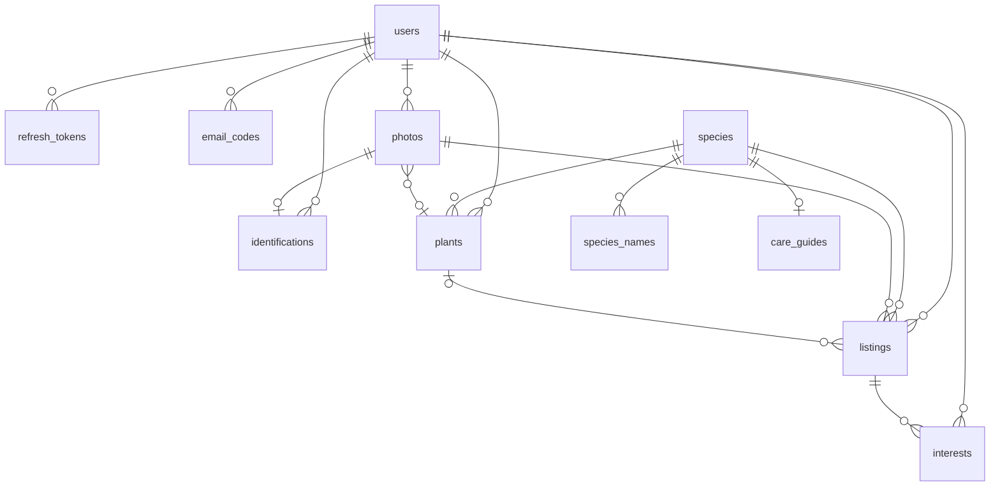

# Modelo de dados e contrato da API

Resultado do ticket [Modelo de dados e contrato da API](https://github.com/angelobez/plantai/issues/10). É material de consulta para o `/to-spec` e para o plano de entregas. Os termos seguem o [`CONTEXT.md`](../../CONTEXT.md), que também dá o nome de cada um no código.

Decisões que este documento pressupõe:

- [ADR 0001](../adr/0001-autenticacao-propria-uma-conta-por-email.md): autenticação própria.
- [ADR 0002](../adr/0002-localizacao-de-doacao-arredondada-antes-de-salvar.md): localização arredondada.
- [ADR 0004](../adr/0004-api-no-aws-lambda-com-function-url.md): Lambda, S3 e Neon.
- [ADR 0006](../adr/0006-drizzle-como-orm.md): Drizzle.
- [ADR 0007](../adr/0007-fotos-pela-api-e-telefone-so-pelo-interesse.md): fotos pela API e telefone só pelo Interesse.

## Convenções

- **Banco:** PostgreSQL com PostGIS (`postgis`, `unaccent`, `citext` e `pg_trgm`), schema e migrations em Drizzle.
- **IDs:** UUIDv7 em tudo que aparece na API. Datas em `timestamptz`; na API, ISO 8601 em UTC.
- **"Hoje":** o dia vira à meia-noite de `America/Sao_Paulo`. É o que vale para os limites diários.
- **Contrato:** REST com JSON e prefixo `/v1`. Os schemas Zod são a fonte única de verdade; deles sai o OpenAPI, servido em `/docs`. No CI, um teste compara o OpenAPI com o snapshot versionado.
- **No app:** models Dart escritos à mão, com `json_serializable`.
- **Erros:** `application/problem+json` (RFC 9457) com `type` (`about:blank`), `title`, `status` e um campo `code` estável. A mensagem para a pessoa fica no app, não na API. Todo erro sai nesse formato, inclusive os que não são de domínio. Dos erros HTTP do framework, só três têm tradução: o `400` (JSON malformado, por exemplo) vira `VALIDATION_FAILED` com uma mensagem genérica, sem o texto interno do Nest; o `404` (rota inexistente) vira `NOT_FOUND`; e o `429` vira `TOO_MANY_REQUESTS`. Qualquer outro erro, inclusive outro erro HTTP do framework (um `403` sem código de domínio, por exemplo; o `401` da falta de token é o `UNAUTHENTICATED`), vira `INTERNAL_ERROR`, sem stack trace nem mensagem interna no corpo, e vai para o log como erro sem mapeamento.
- **Versão do app:** o app manda `X-App-Version` (semver) em toda requisição. Abaixo da versão mínima configurada (`MIN_APP_VERSION`), a API responde `426` com `APP_UPDATE_REQUIRED`, e o app mostra "atualize o PlantAí" com o link do GitHub Release. Vale para todas as rotas, inclusive o `GET /health`. **Sem o cabeçalho, a requisição passa**, para que `curl` e o `/docs` funcionem. Um valor que não é semver responde `400 VALIDATION_FAILED`.
- **Logs:** o logger de requisições nunca registra o valor dos cabeçalhos `Authorization`, `Cookie`, `Proxy-Authorization`, `Set-Cookie` e `X-Search-Location`; eles aparecem como `[REDACTED]`.

## Modelo de dados



### Conta (ver ADR 0001)

**`users`**

| Coluna | Tipo | Observação |
|---|---|---|
| `id` | uuid | |
| `email` | citext, único | |
| `email_verified_at` | timestamptz, nulo | A conta só funciona com valor |
| `password_hash` | text, nulo | argon2id. Nulo para quem só entrou pelo Google |
| `google_sub` | text, único, nulo | |
| `name` | text | Editável |
| `phone` | text, nulo | E.164, só Brasil, celular com DDD (`libphonenumber-js`) |
| `donation_location` | geography(Point, 4326), nulo | Já arredondada no centro da célula de ~1 km |
| `donation_neighborhood` | text, nulo | |
| `created_at` | timestamptz | |

**`refresh_tokens`**: `id`, `user_id`, `token_hash`, `family_id` (para revogar a família inteira quando um token já usado reaparece), `expires_at` (30 dias), `revoked_at`, `created_at`.

**`email_codes`**: `id`, `user_id`, `purpose` (`signup` | `password_reset`), `code_hash`, `expires_at` (15 min), `attempts`, `used_at`, `created_at`.

### Catálogo

**`species`**

| Coluna | Tipo | Observação |
|---|---|---|
| `id` | uuid | |
| `gbif_key` | integer, único | A identidade da Espécie. Semente e Pl@ntNet se encontram por ela. Se o Pl@ntNet não trouxer `gbif.id`, a API busca o nome no GBIF |
| `scientific_name` | text, único | Sem autor |
| `reference_photo_s3_key` | text, nulo | Foto própria (semente, copiada do Wikimedia) |
| `reference_photo_url` | text, nulo | Foto externa (espécie vinda do Pl@ntNet, exibida pela URL deles) |
| `reference_photo_author` | text | |
| `reference_photo_license` | text | |
| `reference_photo_source_url` | text | Para o crédito |
| `origin` | `seed` \| `identification` | |
| `created_at` | timestamptz | |

Exatamente um dos dois campos de foto (`reference_photo_s3_key` ou `reference_photo_url`) tem valor (`CHECK`). Na carga da semente, a espécie nasce com a URL do Wikimedia em `reference_photo_url` e passa para `reference_photo_s3_key` quando a cópia para o armazenamento dá certo; se a cópia falhar, a foto continua pela URL externa até a próxima carga.

**`species_names`**: `id`, `species_id`, `name`, `name_normalized` (coluna gerada com `lower(unaccent(name))`), `is_primary`.
- Um índice único parcial garante um só `is_primary` por espécie, e `(species_id, name)` é único, para a carga da semente não duplicar nomes.
- O `unaccent` não é `IMMUTABLE`; a coluna gerada e os índices usam o wrapper `public.immutable_unaccent`. A busca tem índices trigram (`pg_trgm`) em `name_normalized` e em `lower(immutable_unaccent(scientific_name))`.
- **O nome principal da semente:** vem da Flora e Funga do Brasil.
- **O nome principal de uma espécie nova:** vem do Claude.
- **O nome do Claude quando já existe um principal:** entra como nome alternativo, se for diferente.

**`care_guides`** (Dicas de cuidado, uma por espécie)

| Coluna | Tipo | Observação |
|---|---|---|
| `species_id` | uuid, PK | |
| `status` | `generating` \| `ready` \| `failed` | |
| `content` | jsonb, nulo | Formato abaixo, validado pelo Zod |
| `model` | text | Ex.: `claude-sonnet-5-5` |
| `prompt_version` | integer | Para gerar de novo depois |
| `requested_by` | uuid, nulo | Usuário que causou a geração (contagem de uso de IA). Nulo na semente |
| `started_at`, `generated_at` | timestamptz | |

```ts
// content
{
  commonName: string,                       // nome popular brasileiro
  watering:    { summary: string, details: string },  // summary até ~25 caracteres: "1x por semana"
  light:       { summary: string, details: string },  // "Meia-sombra"
  propagation: { summary: string, details: string },  // "Estaca"
}
```

### Fotos e identificação

**`photos`**

| Coluna | Tipo | Observação |
|---|---|---|
| `id` | uuid | |
| `owner_id` | uuid | |
| `s3_key` | text | Bucket privado. O EXIF já foi removido |
| `width`, `height` | integer | |
| `plant_id` | uuid, nulo | A Planta a que a foto pertence. É uma tabela própria para permitir várias fotos por planta no futuro |
| `attached_at` | timestamptz, nulo | Preenchida quando a foto passa a ser usada por uma identificação, planta ou anúncio |
| `created_at` | timestamptz | |

Fotos órfãs: o upload grava o objeto com a tag `unattached=true`, que sai quando a foto é anexada. Uma regra de ciclo de vida do S3 apaga os objetos com essa tag depois de 1 dia. A linha órfã no banco não incomoda; ela pode ser limpa junto com o ping do Neon, se esse job vier a existir.

**`identifications`**

| Coluna | Tipo | Observação |
|---|---|---|
| `id` | uuid | |
| `user_id` | uuid | |
| `photo_id` | uuid, nulo | `ON DELETE SET NULL`: a foto some com a planta, mas a linha fica, porque conta o uso do Pl@ntNet |
| `result` | `recognized` \| `not_recognized` | `not_recognized` quando o top 1 tem `score` < 0,2 ou não há candidatos |
| `candidates` | jsonb | Até 3: `scientificName`, `commonName` (`pt`, cru do Pl@ntNet), `score`, `gbifKey`, `images[]` com `url`, `author` e `license` |
| `chosen_species_id` | uuid, nulo | |
| `chosen_none` | boolean | O usuário marcou "nenhuma destas" |
| `chosen_at` | timestamptz, nulo | |
| `created_at` | timestamptz | |

**Limite diário:** toda linha de `identifications` conta no limite de 10 por usuário por dia, inclusive as `not_recognized`, porque gastam a cota do Pl@ntNet do mesmo jeito. A falha de rede e o 5xx do Pl@ntNet não geram linha, então não contam.

**Espécie nova:** só nasce quando o usuário escolhe o candidato. Nesse momento, a API faz o upsert pela `gbif_key`, e a foto de referência passa a ser a primeira imagem que o Pl@ntNet mostrou daquele candidato.

### Jardim

**`plants`**: `id`, `user_id`, `common_name` (apelido livre, obrigatório), `species_id` (nulo; definido uma vez e depois imutável), `created_at`. A foto vem de `photos.plant_id`.

**Remover a planta:**
- A linha da planta é apagada.
- Os anúncios que nasceram dela ficam com `plant_id = null`.
- As fotos da planta que algum anúncio usa ficam, com `plant_id = null`. As outras são apagadas do banco e do S3.

### Doação

**`listings`** (Anúncio)

| Coluna | Tipo | Observação |
|---|---|---|
| `id` | uuid | |
| `user_id` | uuid | O Doador |
| `plant_id` | uuid, nulo | `ON DELETE SET NULL`. Não é usado no MVP; prepara a linhagem de mudas |
| `photo_id` | uuid | |
| `common_name` | text | Copiado da planta, editável na criação |
| `species_id` | uuid, nulo | |
| `quantity` | smallint | `CHECK 0..99`. Só chega a 0 pelo "Doei algumas" |
| `note` | varchar(200), nulo | |
| `status` | `active` \| `donated` \| `closed` | Só muda por ação do doador |
| `location` | geography(Point, 4326) | Cópia da localização de doação na criação. Índice GiST |
| `neighborhood` | text | Cópia |
| `expires_at` | timestamptz | Criação ou renovação + 30 dias |
| `created_at`, `updated_at` | timestamptz | |

**Expiração sem job:** um anúncio com `status = active` e `expires_at` no passado é tratado como **Encerrado** em todas as consultas e em toda resposta da API. O status efetivo é calculado numa só função no repositório. Renovar só é permitido nos últimos 7 dias (e não depois de expirado) e faz `expires_at = now() + 30 dias`.

**`interests`**: PK (`listing_id`, `user_id`), `created_at`, `last_opened_at`. Tocar de novo em "Tenho interesse" só atualiza `last_opened_at`. A contagem que o doador vê é o número de linhas.

### Uso de IA por usuário

Não tem tabela própria:
- **Pl@ntNet:** conta-se em `identifications`.
- **Claude:** conta-se em `care_guides.requested_by`.

## Fotos: upload e entrega

1. **Preparo no app:** reduz a foto para cerca de 1600 px no lado maior, JPEG com qualidade ~85, menos de 1 MB.
2. **Envio:** `POST /v1/photos` em multipart. O teto do Lambda é 6 MB.
3. **Na API:** o `sharp` gira a imagem conforme a orientação, remove todo o EXIF (inclusive o GPS) e grava no S3 com a tag `unattached=true`.
4. **Nas respostas:** a foto aparece como `{ id, url, expiresAt }`, em que `url` é pré-assinada e vale 1 h. O app usa o `id` como chave de cache no `cached_network_image`.
5. **Local:** em vez do S3, um emulador (RustFS) no `compose.yaml`, com o bucket privado criado ao subir. O mesmo código fala com os dois; muda só o `.env` (`S3_ENDPOINT` e as chaves só existem no local). A URL pré-assinada é assinada com `http://localhost:9000`, e o `npm run dev:phone` faz `adb reverse` dessa porta. A regra de ciclo de vida não existe no emulador.
6. **Fotos de referência:** as do Catálogo e as dos candidatos vêm como `{ url, author, license, sourceUrl }`. A `url` é pré-assinada (S3) ou externa (Pl@ntNet).

## Endpoints

Todos ficam sob `/v1`, e todos exigem `Authorization: Bearer <access token>`, exceto os de `/auth` e o `GET /health`.

### Saúde

| Método e caminho | O que faz |
|---|---|
| `GET /health` | Público. Lê a versão do PostGIS no banco e responde `{ status: "ok", apiVersion, postgisVersion }`, com `apiVersion` vindo do `package.json`. Com o banco fora, `HEALTH_CHECK_FAILED` |

### Autenticação (ADR 0001)

| Método e caminho | O que faz |
|---|---|
| `POST /auth/google` | `{ idToken }` → tokens. Junta com a conta do mesmo e-mail pelas regras do ADR |
| `POST /auth/signup` | `{ name, email, password }` → `202` sem corpo, igual para e-mail novo, conta não confirmada e conta confirmada, para não revelar se o e-mail tem conta. E-mail novo: cria o Usuário não confirmado e envia o código. Conta não confirmada: troca nome e senha e envia outro código (é o "reenviar código" do app). Conta confirmada: não muda nada e envia o e-mail "você já tem conta" |
| `POST /auth/verify-email` | `{ email, code }` → tokens |
| `POST /auth/login` | `{ email, password }` → tokens |
| `POST /auth/refresh` | `{ refreshToken }` → tokens (com rotação) |
| `POST /auth/logout` | Revoga o refresh token |
| `POST /auth/password-reset/request` | `{ email }` → sempre `204`, para não revelar se o e-mail existe |
| `POST /auth/password-reset/confirm` | `{ email, code, newPassword }` → tokens |

A resposta com tokens tem o formato `{ accessToken, refreshToken, user }`. O throttler limita por IP e por e-mail.

### Perfil

| Método e caminho | O que faz |
|---|---|
| `GET /me` | `{ id, name, email, phone, donationLocation: { neighborhood } \| null }`. As coordenadas não voltam |
| `PATCH /me` | `{ name }` |
| `PUT /me/donation-profile` | `{ phone, lat, lng, neighborhood }`. A API valida o telefone e arredonda o ponto antes de salvar. É usado no primeiro anúncio e no Perfil |

### Fotos, identificação e Catálogo

| Método e caminho | O que faz |
|---|---|
| `POST /photos` | Multipart `file` → `{ id, url, expiresAt }`. Limite de 50 por dia (`PHOTO_DAILY_LIMIT`) |
| `POST /identifications` | `{ photoId }` → `{ id, result, candidates[], remainingToday }`. Chamada síncrona ao Pl@ntNet (~2 s). Se `result = not_recognized`, vem `candidates: []` |
| `POST /identifications/:id/choice` | `{ candidateIndex }` ou `{ none: true }` → `{ species }` ou `204`. Faz o upsert da Espécie no Catálogo |
| `GET /species?q=` | Busca sem diferenciar acento nem maiúscula (`ILIKE '%termo%'` em `name_normalized`), até 20 resultados. Cada item: `{ id, commonName, scientificName, referencePhoto, matchedAlternativeName \| null }` |
| `GET /species/:id` | `{ id, commonName, scientificName, referencePhoto, otherNames[], careGuide }` |

**`careGuide` no `GET /species/:id`:**
- **Já existe e está `ready`:** vem o conteúdo.
- **Não existe ou está `failed`:** a API marca `generating`, chama o Claude na hora (5 a 10 s), valida a resposta, guarda e devolve.
- **Outra requisição já está gerando:** responde `202` com `Retry-After: 3`, e o app tenta de novo.
- **O Claude falha:** a linha fica `failed`, a resposta vem com `careGuide: null` e `careGuideStatus: "unavailable"`, e a próxima abertura tenta outra vez.

Um `generating` com mais de 60 s é tratado como `failed`.

### Meu jardim

| Método e caminho | O que faz |
|---|---|
| `GET /plants` | Lista: `{ id, commonName, photo, species: { id, scientificName, wateringSummary } \| null }` |
| `POST /plants` | `{ photoId, commonName, speciesId? }` → planta. Anexa a foto |
| `GET /plants/:id` | Planta com a espécie completa e o `careGuide` (mesma regra do `GET /species/:id`) |
| `PATCH /plants/:id` | `{ commonName? , speciesId? }`. Só aceita `speciesId` se a planta ainda não tiver espécie (`SPECIES_ALREADY_SET`) |
| `DELETE /plants/:id` | Remove a planta pelas regras acima |

### Anúncios e interesse

| Método e caminho | O que faz |
|---|---|
| `GET /listings/nearby?page=` | Usa a localização de quem procura (abaixo). Lista os anúncios efetivamente ativos até 30 km (`ST_DWithin`), exceto os do próprio usuário, ordenados por distância, 30 por página. Cada item: `{ id, commonName, scientificName \| null, photo, quantity, distanceKm, neighborhood }` |
| `GET /listings/:id` | `{ ...item, note, donorFirstName, createdAt, careGuide \| null }`. Usa a localização de quem procura para calcular a distância. **Sem telefone** |
| `POST /listings` | `{ photoId, commonName, speciesId?, plantId?, quantity (1..99), note? }`. Sem telefone ou sem localização no perfil: `DONATION_PROFILE_REQUIRED` |
| `GET /me/listings` | Os anúncios do usuário: `{ id, commonName, photo, status, quantity, interestCount, expiresAt, canRenew }` |
| `PATCH /listings/:id` | `{ quantity? (1..99), note? }`. Só se o anúncio estiver ativo |
| `POST /listings/:id/donations` | `{ count }`. Desconta da quantidade e, se chegar a 0, o anúncio vira `donated`. `count` maior que a quantidade: `INVALID_DONATION_COUNT` |
| `POST /listings/:id/close` | Vira `closed` |
| `POST /listings/:id/renew` | Só nos últimos 7 dias (`RENEWAL_NOT_ALLOWED`) |
| `POST /listings/:id/interest` | Registra ou atualiza o Interesse e devolve `{ whatsappUrl }`, o `https://wa.me/<telefone sem +>?text=...` com a mensagem padrão. Não aceita o próprio anúncio (`OWN_LISTING`) nem anúncio que não esteja ativo (`LISTING_NOT_ACTIVE`) |

**Localização de quem procura:** vai no cabeçalho `X-Search-Location: <lat>,<lng>` e não na query string, para não parar em log de acesso (CloudFront e Lambda). O logger da API não registra esse cabeçalho. Sem ele, a resposta é `LOCATION_REQUIRED`.

**`distanceKm`:** distância entre a localização de quem procura e o centro da célula do anúncio, arredondada para inteiro. `0` significa "menos de 1 km", e o app monta o texto ("a cerca de 2 km").

**Situação em todas as respostas:** o `status` é sempre o efetivo, com o anúncio expirado aparecendo como `closed`.

## Códigos de erro

| `code` | HTTP | Quando |
|---|---|---|
| `APP_UPDATE_REQUIRED` | 426 | `X-App-Version` abaixo da mínima |
| `VALIDATION_FAILED` | 400 | Zod rejeitou a requisição, o JSON veio malformado (ou outro `400` do framework) ou o `X-App-Version` não é semver. Detalhes em `errors[]`, de `{ path, message }`, com `path` no formato `tags.1` (vazio quando o problema é a requisição inteira; `X-App-Version` para o cabeçalho). Para o `400` do framework, a mensagem é genérica |
| `UNAUTHENTICATED` | 401 | Rota protegida sem `Authorization: Bearer`, ou com access token inválido ou vencido. O app reage renovando a sessão (`POST /auth/refresh`); o refresh token revogado ou vencido também responde este código |
| `INVALID_CREDENTIALS` | 401 | Mensagem genérica, igual para e-mail inexistente e senha errada |
| `EMAIL_NOT_VERIFIED` | 403 | Login antes de confirmar o código |
| `INVALID_CODE` | 400 | Código errado, expirado ou com tentativas esgotadas |
| `GOOGLE_ACCOUNT_LINK_REFUSED` | 409 | E-mail do Google sem as garantias do ADR 0001: "entre com a senha" |
| `TOO_MANY_REQUESTS` | 429 | Throttler da autenticação; também todo `429` do framework |
| `PHOTO_DAILY_LIMIT` | 429 | Mais de 50 fotos no dia |
| `IDENTIFICATION_DAILY_LIMIT` | 429 | 10 identificações no dia |
| `IDENTIFICATION_SERVICE_UNAVAILABLE` | 503 | Falha ou timeout do Pl@ntNet (não conta no limite) |
| `CARE_GUIDE_GENERATING` | 202 | Outra requisição está gerando as dicas |
| `SPECIES_ALREADY_SET` | 409 | Tentativa de trocar a espécie de uma planta |
| `DONATION_PROFILE_REQUIRED` | 409 | Primeiro anúncio sem telefone ou localização |
| `INVALID_PHONE` | 400 | Telefone fora do formato de celular brasileiro |
| `LOCATION_REQUIRED` | 400 | Falta o `X-Search-Location` |
| `LISTING_NOT_ACTIVE` | 409 | Ação que exige anúncio ativo |
| `INVALID_DONATION_COUNT` | 400 | "Doei algumas" acima da quantidade |
| `RENEWAL_NOT_ALLOWED` | 409 | Renovar fora dos últimos 7 dias |
| `OWN_LISTING` | 409 | Interesse no próprio anúncio |
| `NOT_FOUND` | 404 | Também para recurso de outro usuário, para não revelar que existe, e para rota inexistente |
| `HEALTH_CHECK_FAILED` | 503 | O `GET /health` não conseguiu ler o banco |
| `INTERNAL_ERROR` | 500 | Erro inesperado, inclusive erro HTTP do framework sem mapeamento (qualquer um fora de `400`, `404` e `429`). O corpo não traz stack trace nem mensagem interna; o detalhe fica só no log |

"Foto não reconhecida" não é erro: é `result: "not_recognized"` na resposta de `POST /identifications`, com `remainingToday`.

## Semente do Catálogo

- **`api/scripts/build-catalog-seed`:** monta o `api/catalog/catalog-seed.json`. Passos:
  1. O Claude propõe cerca de 100 espécies.
  2. O script valida cada nome no GBIF, descarta o que não bate e corrige os sinônimos, guardando a `gbifKey`.
  3. Busca os nomes populares na Flora e Funga do Brasil, com o GBIF (`por`) de reserva.
  4. Escolhe uma foto do Wikimedia Commons com licença livre (nunca NC) e registra autor, licença e URL de origem.
- **Revisão:** o Ângelo revisa o JSON no PR.
- **`npm run catalog:load`:** roda à mão, uma vez por ambiente. Lê o JSON, faz o upsert pela `gbif_key`, copia as fotos para o S3 e gera, pelo mesmo código da API, as dicas que faltam. É idempotente: rodar de novo só completa o que falhou.
- **Não é uma migration:** a carga chama serviços externos e pode parar no meio, e as migrations do Drizzle ficam só com o schema.
