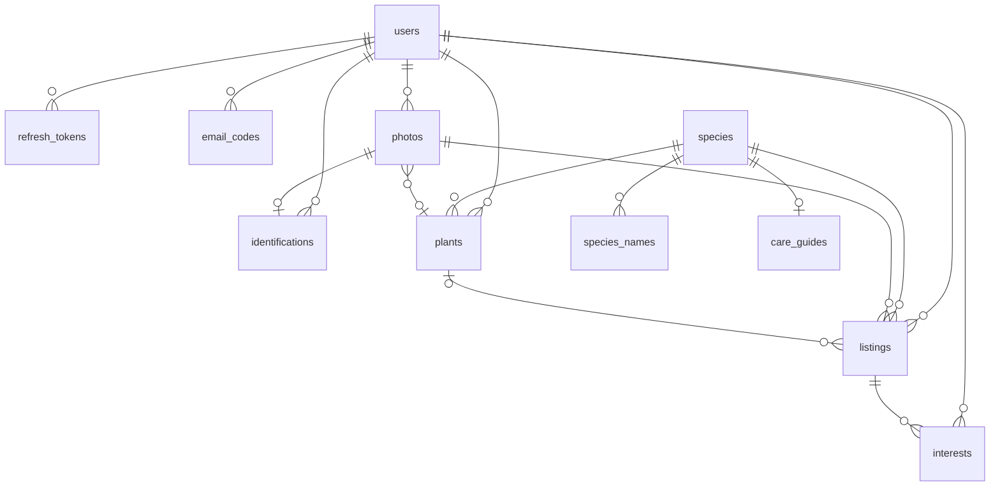

# Modelo de dados e contrato da API

Resultado do ticket [Modelo de dados e contrato da API](https://github.com/angelobez/plantai/issues/10). É material de consulta para o `/to-spec` e para o plano de entregas. Os termos seguem o [`CONTEXT.md`](../../CONTEXT.md), que também dá o nome de cada um no código.

Decisões que este documento pressupõe:

- [ADR 0001](../adr/0001-autenticacao-propria-uma-conta-por-email.md): autenticação própria.
- [ADR 0002](../adr/0002-localizacao-de-doacao-arredondada-antes-de-salvar.md): localização arredondada.
- [ADR 0004](../adr/0004-api-no-aws-lambda-com-function-url.md): Lambda, S3 e Neon.
- [ADR 0006](../adr/0006-drizzle-como-orm.md): Drizzle.
- [ADR 0007](../adr/0007-fotos-pela-api-e-telefone-so-pelo-interesse.md): fotos pela API e telefone só pelo Interesse.

## Convenções

- **Banco:** PostgreSQL com PostGIS (`postgis`, `unaccent`, `citext` e `pg_trgm`), schema e migrations em Drizzle.
- **IDs:** UUIDv7 em tudo que aparece na API. Datas em `timestamptz`; na API, ISO 8601 em UTC.
- **"Hoje":** o dia vira à meia-noite de `America/Sao_Paulo`. É o que vale para os limites diários.
- **Contrato:** REST com JSON e prefixo `/v1`. Os schemas Zod são a fonte única de verdade; deles sai o OpenAPI, servido em `/docs`. No CI, um teste compara o OpenAPI com o snapshot versionado.
- **No app:** models Dart escritos à mão, com `json_serializable`.
- **Erros:** `application/problem+json` (RFC 9457) com `type` (`about:blank`), `title`, `status` e um campo `code` estável. A mensagem para a pessoa fica no app, não na API. Todo erro sai nesse formato, inclusive os que não são de domínio. Dos erros HTTP do framework, só três têm tradução: o `400` (JSON malformado, por exemplo) vira `VALIDATION_FAILED` com uma mensagem genérica, sem o texto interno do Nest; o `404` (rota inexistente) vira `NOT_FOUND`; e o `429` vira `TOO_MANY_REQUESTS`. Qualquer outro erro, inclusive outro erro HTTP do framework (um `403` sem código de domínio, por exemplo; o `401` da falta de token é o `UNAUTHENTICATED`), vira `INTERNAL_ERROR`, sem stack trace nem mensagem interna no corpo, e vai para o log como erro sem mapeamento.
- **Versão do app:** o app manda `X-App-Version` (semver) em toda requisição. Abaixo da versão mínima configurada (`MIN_APP_VERSION`), a API responde `426` com `APP_UPDATE_REQUIRED`, e o app mostra "atualize o PlantAí" com o link do GitHub Release. Vale para todas as rotas, inclusive o `GET /health`. **Sem o cabeçalho, a requisição passa**, para que `curl` e o `/docs` funcionem. Um valor que não é semver responde `400 VALIDATION_FAILED`.
- **Logs:** o logger de requisições nunca registra o valor dos cabeçalhos `Authorization`, `Cookie`, `Proxy-Authorization`, `Set-Cookie` e `X-Search-Location`; eles aparecem como `[REDACTED]`.

## Modelo de dados



### Conta (ver ADR 0001)

**`users`**

| Coluna | Tipo | Observação |
|---|---|---|
| `id` | uuid | |
| `email` | citext, único | |
| `email_verified_at` | timestamptz, nulo | A conta só funciona com valor |
| `password_hash` | text, nulo | argon2id. Nulo para quem só entrou pelo Google |
| `google_sub` | text, único, nulo | |
| `name` | text | Editável |
| `phone` | text, nulo | E.164, só Brasil, celular com DDD (`libphonenumber-js`) |
| `donation_location` | geography(Point, 4326), nulo | Já arredondada no centro da célula de ~1 km |
| `donation_neighborhood` | text, nulo | |
| `created_at` | timestamptz | |

**`refresh_tokens`**: `id`, `user_id`, `token_hash`, `family_id` (para revogar a família inteira quando um token já usado reaparece), `expires_at` (30 dias), `revoked_at`, `created_at`.

**`email_codes`**: `id`, `user_id`, `purpose` (`signup` | `password_reset`), `code_hash`, `expires_at` (15 min), `attempts`, `used_at`, `created_at`.

### Catálogo

**`species`**

| Coluna | Tipo | Observação |
|---|---|---|
| `id` | uuid | |
| `gbif_key` | integer, único | A identidade da Espécie. Semente e Pl@ntNet se encontram por ela. Se o Pl@ntNet não trouxer `gbif.id`, a API busca o nome no GBIF |
| `scientific_name` | text, único | Sem autor |
| `reference_photo_s3_key` | text, nulo | Foto própria (semente, copiada do Wikimedia) |
| `reference_photo_url` | text, nulo | Foto externa (espécie vinda do Pl@ntNet, exibida pela URL deles) |
| `reference_photo_author` | text | |
| `reference_photo_license` | text | |
| `reference_photo_source_url` | text | Para o crédito |
| `origin` | `seed` \| `identification` | |
| `created_at` | timestamptz | |

Exatamente um dos dois campos de foto (`reference_photo_s3_key` ou `reference_photo_url`) tem valor (`CHECK`). Na carga da semente, a espécie nasce com a URL do Wikimedia em `reference_photo_url` e passa para `reference_photo_s3_key` quando a cópia para o armazenamento dá certo; se a cópia falhar, a foto continua pela URL externa até a próxima carga.

**`species_names`**: `id`, `species_id`, `name`, `name_normalized` (coluna gerada com `lower(unaccent(name))`), `is_primary`.
- Um índice único parcial garante um só `is_primary` por espécie, e `(species_id, name)` é único, para a carga da semente não duplicar nomes.
- O `unaccent` não é `IMMUTABLE`; a coluna gerada e os índices usam o wrapper `public.immutable_unaccent`. A busca tem índices trigram (`pg_trgm`) em `name_normalized` e em `lower(immutable_unaccent(scientific_name))`.
- **O nome principal da semente:** vem da Flora e Funga do Brasil, a não ser que o `api/catalog/seed-overrides.json` o corrija à mão.
- **O nome principal de uma espécie nova:** o `commonName` que o candidato mostrou na identificação, exatamente como apareceu. Só quando o candidato não mostrou nome (`null`), o principal vem do Claude, nas primeiras dicas.
- **O nome do Claude quando já existe um principal:** entra como nome alternativo, se for diferente.

**`care_guides`** (Dicas de cuidado, uma por espécie)

| Coluna | Tipo | Observação |
|---|---|---|
| `species_id` | uuid, PK | |
| `status` | `generating` \| `ready` \| `failed` | |
| `content` | jsonb, nulo | Formato abaixo, validado pelo Zod |
| `model` | text | Ex.: `claude-sonnet-5-5` |
| `prompt_version` | integer | Para gerar de novo depois |
| `requested_by` | uuid, nulo | Usuário que causou a geração (contagem de uso de IA). Nulo na semente |
| `started_at`, `generated_at` | timestamptz | |

```ts
// content
{
  commonName: string,                       // nome popular brasileiro
  watering:    { summary: string, details: string },  // summary até ~25 caracteres: "1x por semana"
  light:       { summary: string, details: string },  // "Meia-sombra"
  propagation: { summary: string, details: string },  // "Estaca"
}
```

### Fotos e identificação

**`photos`**

| Coluna | Tipo | Observação |
|---|---|---|
| `id` | uuid | |
| `owner_id` | uuid | |
| `s3_key` | text | Bucket privado. O EXIF já foi removido |
| `width`, `height` | integer | |
| `plant_id` | uuid, nulo | A Planta a que a foto pertence. É uma tabela própria para permitir várias fotos por planta no futuro |
| `attached_at` | timestamptz, nulo | Preenchida quando a foto passa a ser usada por uma identificação, planta ou anúncio |
| `created_at` | timestamptz | |

Fotos órfãs: o upload grava o objeto com a tag `unattached=true`, que sai quando a foto é anexada. Uma regra de ciclo de vida do S3 apaga os objetos com essa tag depois de 1 dia. A linha órfã no banco não incomoda; ela pode ser limpa junto com o ping do Neon, se esse job vier a existir.

**`identifications`**

| Coluna | Tipo | Observação |
|---|---|---|
| `id` | uuid | |
| `user_id` | uuid | |
| `photo_id` | uuid, nulo | `ON DELETE SET NULL`: a foto some com a planta, mas a linha fica, porque conta o uso do Pl@ntNet |
| `result` | `recognized` \| `not_recognized` | `not_recognized` quando o top 1 tem `score` < 0,2 ou não há candidatos |
| `candidates` | jsonb | Até 3: `scientificName`, `commonNames` (`pt`, crus do Pl@ntNet), `score`, `gbifKey`, `images[]` com `url`, `author`, `license` e `sourceUrl`. Numa `recognized`, são os candidatos mostrados, na mesma ordem (o `candidateIndex` aponta para eles), já com a `gbifKey` resolvida no GBIF; numa `not_recognized`, a lista crua do Pl@ntNet |
| `chosen_species_id` | uuid, nulo | |
| `chosen_none` | boolean | O usuário marcou "nenhuma destas" |
| `chosen_at` | timestamptz, nulo | |
| `created_at` | timestamptz | |

**Limite diário:** toda linha de `identifications` conta no limite de 10 por usuário por dia, inclusive as `not_recognized`, porque gastam a cota do Pl@ntNet do mesmo jeito. A falha de rede e o 5xx do Pl@ntNet não geram linha, então não contam.

**Espécie nova:** só nasce quando o usuário escolhe o candidato. Nesse momento, a API faz o upsert pela `gbif_key`, e a foto de referência passa a ser a primeira imagem que o Pl@ntNet mostrou daquele candidato (`reference_photo_url`, com `origin = identification`). Ela nasce com o `commonName` que o candidato mostrou como nome principal em `species_names` (o primeiro nome do Pl@ntNet que passa no filtro, com o hífen corrigido); os outros nomes do Pl@ntNet não são guardados. Se o candidato não mostrou nome, ela nasce sem nome, o principal vem do Claude na primeira geração das dicas e, até lá, toda resposta usa o nome científico como `commonName`. Uma espécie que já existe fica com os nomes que tem.

### Jardim

**`plants`**: `id`, `user_id`, `common_name` (apelido livre, obrigatório), `species_id` (nulo; definido uma vez e depois imutável), `created_at`. A foto vem de `photos.plant_id`.

**Remover a planta:**
- A linha da planta é apagada.
- Os anúncios que nasceram dela ficam com `plant_id = null`.
- As fotos da planta que algum anúncio usa ficam, com `plant_id = null`. As outras são apagadas do banco e do S3.

### Doação

**`listings`** (Anúncio)

| Coluna | Tipo | Observação |
|---|---|---|
| `id` | uuid | |
| `user_id` | uuid | O Doador |
| `plant_id` | uuid, nulo | `ON DELETE SET NULL`. Não é usado no MVP; prepara a linhagem de mudas |
| `photo_id` | uuid | |
| `common_name` | text | Copiado da planta, editável na criação |
| `species_id` | uuid, nulo | |
| `quantity` | smallint | `CHECK 0..99`. Só chega a 0 pelo "Doei algumas" |
| `note` | varchar(200), nulo | |
| `status` | `active` \| `donated` \| `closed` | Só muda por ação do doador |
| `location` | geography(Point, 4326) | Cópia da localização de doação na criação. Índice GiST |
| `neighborhood` | text | Cópia |
| `expires_at` | timestamptz | Criação ou renovação + 30 dias |
| `created_at`, `updated_at` | timestamptz | |

**Expiração sem job:** um anúncio com `status = active` e `expires_at` no passado é tratado como **Encerrado** em todas as consultas e em toda resposta da API. O status efetivo é calculado numa só função (`api/src/listings/listing-status.ts`), que toda consulta e toda resposta usam. Renovar só é permitido nos últimos 7 dias (e não depois de expirado) e faz `expires_at = now() + 30 dias`.

**`interests`**: PK (`listing_id`, `user_id`), `created_at`, `last_opened_at`. Tocar de novo em "Tenho interesse" só atualiza `last_opened_at`. A contagem que o doador vê é o número de linhas.

### Uso de IA por usuário

Não tem tabela própria:
- **Pl@ntNet:** conta-se em `identifications`.
- **Claude:** conta-se em `care_guides.requested_by`.

## Fotos: upload e entrega

1. **Preparo no app:** reduz a foto para cerca de 1600 px no lado maior, JPEG com qualidade ~85, menos de 1 MB.
2. **Envio:** `POST /v1/photos` em multipart. O teto do Lambda é 6 MB.
3. **Na API:** o `sharp` gira a imagem conforme a orientação, remove todo o EXIF (inclusive o GPS) e grava no S3 com a tag `unattached=true`.
4. **Nas respostas:** a foto aparece como `{ id, url, expiresAt }`, em que `url` é pré-assinada e vale 1 h. O app usa o `id` como chave de cache no `cached_network_image`.
5. **Local:** em vez do S3, um emulador (RustFS) no `compose.yaml`, com o bucket privado criado ao subir. O mesmo código fala com os dois; muda só o `.env` (`S3_ENDPOINT` e as chaves só existem no local). A URL pré-assinada é assinada com `http://localhost:9000`, e o `npm run dev:phone` faz `adb reverse` dessa porta. A regra de ciclo de vida não existe no emulador.
6. **Fotos de referência:** as do Catálogo e as dos candidatos vêm como `{ url, author, license, sourceUrl }`. A `url` é pré-assinada (S3) ou externa (Pl@ntNet).

## Endpoints

Todos ficam sob `/v1`, e todos exigem `Authorization: Bearer <access token>`, exceto os de `/auth` e o `GET /health`.

### Saúde

| Método e caminho | O que faz |
|---|---|
| `GET /health` | Público. Lê a versão do PostGIS no banco e responde `{ status: "ok", apiVersion, postgisVersion }`, com `apiVersion` vindo do `package.json`. Com o banco fora, `HEALTH_CHECK_FAILED` |

### Autenticação (ADR 0001)

| Método e caminho | O que faz |
|---|---|
| `POST /auth/google` | `{ idToken }` → tokens. Junta com a conta do mesmo e-mail pelas regras do ADR |
| `POST /auth/signup` | `{ name, email, password }` → `202` sem corpo, igual para e-mail novo, conta não confirmada e conta confirmada, para não revelar se o e-mail tem conta. E-mail novo: cria o Usuário não confirmado e envia o código. Conta não confirmada: troca nome e senha e envia outro código (é o "reenviar código" do app). Conta confirmada: não muda nada e envia o e-mail "você já tem conta" |
| `POST /auth/verify-email` | `{ email, code }` → tokens |
| `POST /auth/login` | `{ email, password }` → tokens |
| `POST /auth/refresh` | `{ refreshToken }` → tokens (com rotação) |
| `POST /auth/logout` | Revoga o refresh token |
| `POST /auth/password-reset/request` | `{ email }` → sempre `204`, para não revelar se o e-mail existe |
| `POST /auth/password-reset/confirm` | `{ email, code, newPassword }` → tokens |

A resposta com tokens tem o formato `{ accessToken, refreshToken, user }`. O throttler limita por IP e por e-mail.

### Perfil

| Método e caminho | O que faz |
|---|---|
| `GET /me` | `{ id, name, email, phone, donationLocation: { neighborhood } \| null }`. As coordenadas não voltam |
| `PATCH /me` | `{ name }` |
| `PUT /me/donation-profile` | `{ phone, lat?, lng?, neighborhood }` → `200` com o corpo do `GET /me`. `phone` e `neighborhood` são obrigatórios; `lat` e `lng` vêm juntos ou nenhum dos dois. Sem eles, fica a localização já salva e só mudam telefone e bairro; sem eles e sem localização salva, `VALIDATION_FAILED` em `lat` e `lng`. A API valida o telefone e arredonda o ponto antes de salvar. É usado no primeiro anúncio e no Perfil. Trocar o perfil não muda os anúncios já criados |

**`PUT /me/donation-profile`, campo a campo:**
- **`phone`:** `libphonenumber-js` com país padrão `BR`; aceita com ou sem `+55`, máscara ou espaços. Precisa ser celular brasileiro válido (tipo `MOBILE`); senão, `INVALID_PHONE`. Guardado em E.164 (`+5511987654321`).
- **`lat` e `lng`:** números em `-90..90` e `-180..180`; fora disso, `VALIDATION_FAILED`. Só um dos dois: `VALIDATION_FAILED` no que faltou.
- **`neighborhood`:** de 1 a 60 caracteres depois do trim; fora disso, `VALIDATION_FAILED`.

**Grade de ~1 km (ADR 0002):** o ponto recebido vira o centro da sua célula antes de salvar, e só o centro é guardado; o ponto recebido não vai para o banco nem para o log. As linhas de latitude têm passo fixo de `1 / 111,32` grau (~1 km): linha `i = floor(lat / passo)`, centro `(i + 0,5) × passo`. Dentro da linha, o passo de longitude é o mesmo passo dividido pelo cosseno da latitude do centro da linha, e o centro da coluna sai do mesmo jeito; assim a célula tem ~1 km nos dois sentidos em qualquer latitude, e o centro fica a menos de ~0,71 km do ponto. A função é pura e determinística: dois pontos da mesma célula dão exatamente o mesmo centro.

### Fotos, identificação e Catálogo

| Método e caminho | O que faz |
|---|---|
| `POST /photos` | Multipart `file` (até 6 MB) → `201` com `{ id, url, expiresAt }`. Limite de 50 por dia (`PHOTO_DAILY_LIMIT`). Arquivo que não é imagem, campo ausente, corpo que não é multipart ou arquivo acima de 6 MB: `VALIDATION_FAILED`, com `path` `file` |
| `POST /identifications` | `{ photoId }` → `201` com `{ id, result, candidates[], remainingToday }`. Chamada síncrona ao Pl@ntNet (~2 s). Passos abaixo. Se `result = not_recognized`, vem `candidates: []`. Foto de outro usuário ou inexistente: `NOT_FOUND` |
| `POST /identifications/:id/choice` | `{ candidateIndex }` ou `{ none: true }`, nunca os dois → `200` com `{ species }` (no formato do item da busca, com `matchedAlternativeName: null`) ou `204`. Faz o upsert da Espécie no Catálogo; a espécie nova ganha o `commonName` do candidato como nome principal. Uma escolha só: a segunda responde `IDENTIFICATION_ALREADY_CHOSEN`. Índice fora da lista, corpo inválido ou identificação `not_recognized`: `VALIDATION_FAILED`. Identificação de outro usuário: `NOT_FOUND` |
| `GET /species?q=` | Busca sem diferenciar acento nem maiúscula: `lower(unaccent(q))` com `ILIKE '%termo%'` em `name_normalized` e no nome científico normalizado. `q` de 2 a 50 caracteres depois do trim (fora disso, `VALIDATION_FAILED`); `%` e `_` valem como letras. Responde uma lista com uma linha por espécie, até 20: primeiro as que têm um nome que começa pelo termo, depois as outras, cada grupo em ordem alfabética do nome principal. Cada item: `{ id, commonName, scientificName, referencePhoto, matchedAlternativeName \| null }`; `matchedAlternativeName` é o nome alternativo que bateu, quando o termo não bateu no principal nem no científico |
| `GET /species/:id` | `{ id, commonName, scientificName, referencePhoto, otherNames[], careGuide, careGuideStatus }`, com `otherNames` em ordem alfabética. Espécie inexistente: `NOT_FOUND`; `id` que não é UUID: `VALIDATION_FAILED` |

**`POST /identifications`, passo a passo:**
1. Confere o limite de 10 por dia (`IDENTIFICATION_DAILY_LIMIT`), sem chamar o Pl@ntNet.
2. Lê a foto no armazenamento e chama o Pl@ntNet (`POST /v2/identify/all` com `lang=pt`, `nb-results=3`, `organs=auto` e `include-related-images=true`, timeout de 10 s). O `404` "Species not found" vale como lista vazia. Timeout, rede, `5xx` e qualquer outra resposta: `IDENTIFICATION_SERVICE_UNAVAILABLE`, sem linha.
3. Candidato sem `gbif.id`: a API resolve o nome no GBIF; sem match (ou com o GBIF fora), ele é descartado. Candidato sem imagem cuja espécie não está no Catálogo também é descartado, porque uma Espécie nova precisa de foto de referência.
4. `not_recognized` quando não sobra candidato ou quando o top 1 do Pl@ntNet (antes dos descartes) tem `score` < 0,2.
5. Anexa a foto, grava a linha e responde.

**Cada candidato:** `{ scientificName, commonName, score, images[] }`, com `images` no formato `{ url, author, license, sourceUrl }`: `url` é a imagem média do Pl@ntNet, `sourceUrl` é a original e a licença vem como `CC BY-SA`. O `commonName`:
- **Espécie já no Catálogo (pela `gbifKey`):** o nome principal do Catálogo; enquanto ela não tem nome principal, o nome científico, como em toda resposta.
- **Senão:** o primeiro nome do Pl@ntNet que passa no filtro de "parece nome": até 40 caracteres, sem dígitos, sem vírgula e sem ponto. O espaço antes da primeira palavra com hífen volta a ser hífen ("Costela de-adão" vira "Costela-de-adão").
- **Nenhum passou:** `null`, e o app mostra o nome científico.

**Espécie nas respostas do Catálogo:** a espécie sem nome principal usa o nome científico como `commonName`. A `referencePhoto` é `{ url, author, license, sourceUrl }`; a `url` é pré-assinada (1 h) quando a foto está no armazenamento (`reference_photo_s3_key`) e é a URL externa nos outros casos.

**`careGuide` no `GET /species/:id`:**
- **Já existe e está `ready`:** vem o conteúdo.
- **Não existe ou está `failed`:** a API marca `generating`, chama o Claude na hora (5 a 10 s), valida a resposta, guarda e devolve.
- **Outra requisição já está gerando:** responde `202` com `Retry-After: 3`, e o app tenta de novo.
- **O Claude falha:** a linha fica `failed`, a resposta vem com `careGuide: null` e `careGuideStatus: "unavailable"`, e a próxima abertura tenta outra vez.

Um `generating` com mais de 60 s é tratado como `failed`.

**Geração das dicas** (uma só função na API, usada pelo `GET /species/:id`, pelo `GET /plants/:id` e pela carga da semente):
- **Reserva:** um único `INSERT … ON CONFLICT (species_id) DO UPDATE … WHERE status = 'failed' OR (status = 'generating' AND started_at < now() - 60 s)`, que já grava `model`, `prompt_version`, `requested_by` e `started_at`. Só quem ganha a linha chama o Claude.
- **O que o Claude recebe:** o nome científico e os nomes que o Catálogo já tem (o principal primeiro). O prompt pede que o `commonName` repita o primeiro desses nomes, exatamente como está; só sem nenhum nome o Claude escolhe o nome popular mais usado no Brasil. Responde por um tool estrito, cujo JSON Schema sai do schema Zod do `content`; a resposta passa pelo Zod de novo, e uma resposta inválida, uma recusa ou um corte por `max_tokens` contam como falha. Modelo de `CARE_GUIDE_MODEL` (padrão `claude-sonnet-5-5`), `prompt_version` 2, timeout de 25 s com uma nova tentativa, para terminar antes dos 60 s.
- **Sucesso:** `ready`, com `content`, `generated_at` e o `model` que respondeu (o de reserva, se o Claude recusou e o fallback do servidor respondeu).
- **O nome do Claude:** comparado sem acento nem maiúscula. Numa espécie sem nome principal, vira o principal (ou promove o alternativo igual a ele). Numa espécie com principal, entra como alternativo só se a espécie ainda não tem um nome igual.
- **`202 CARE_GUIDE_GENERATING`:** é um `application/problem+json` com `Retry-After: 3`, sem a espécie. O app tenta de novo e, depois de 60 s, mostra "dicas indisponíveis no momento".

### Meu jardim

| Método e caminho | O que faz |
|---|---|
| `GET /plants` | Lista do mais novo para o mais antigo: `{ id, commonName, photo, species: { id, commonName, scientificName, wateringSummary } \| null }`. O `commonName` da espécie é o nome principal (ou o científico, se ela não tiver). `wateringSummary` é o `watering.summary` das dicas `ready`, ou `null`; a lista nunca gera dicas |
| `POST /plants` | `{ photoId, commonName, speciesId? }` → `201` com a planta no formato da lista. `commonName` de 1 a 80 caracteres depois de tirar os espaços das pontas. Anexa a foto (`attached_at`, tira a tag) e grava `photos.plant_id`. Foto de outro Usuário: `NOT_FOUND`. Foto que já é de outra planta ou `speciesId` que não existe: `VALIDATION_FAILED`. Não gera as dicas |
| `GET /plants/:id` | `{ id, commonName, photo, species }`, com `species` igual ao corpo do `GET /species/:id` (nomes, foto de referência, `careGuide` e `careGuideStatus`, pela mesma função de geração, inclusive o `202`), ou `null` na planta salva só com o nome. Planta de outro Usuário: `NOT_FOUND` |
| `PATCH /plants/:id` | `{ commonName? , speciesId? }`, com pelo menos um dos dois (senão, `VALIDATION_FAILED`), e responde a planta no formato da lista; com os dois, aplica os dois. `commonName` segue a regra do `POST`. Só aceita `speciesId` se a planta ainda não tiver espécie (`SPECIES_ALREADY_SET`, inclusive com o mesmo `speciesId`); `speciesId` que não existe: `VALIDATION_FAILED`. A espécie é conferida primeiro: se ela falha, o nome também não muda. Não gera as dicas. Planta de outro Usuário: `NOT_FOUND` |
| `DELETE /plants/:id` | `204`. Apaga a planta e as linhas das fotos dela numa transação e depois os objetos no armazenamento; uma falha ao apagar o objeto vai para o log e não falha a resposta. A foto que algum anúncio usa fica, com `plant_id = null`, e os anúncios ficam (ver "Remover a planta"). Planta de outro Usuário: `NOT_FOUND` |

### Anúncios e interesse

| Método e caminho | O que faz |
|---|---|
| `GET /listings/nearby?page=` | Usa a localização de quem procura (abaixo). Lista os anúncios efetivamente ativos até 30 km (`ST_DWithin` sobre `geography`, até o centro da célula do anúncio), exceto os do próprio usuário, ordenados pela distância e, no empate (anúncios da mesma célula), do mais novo ao mais antigo. `page` é inteiro a partir de 1 (padrão 1; fora disso, `VALIDATION_FAILED`), com 30 itens por página; responde a lista crua, sem total, e o app pede a próxima página enquanto recebe 30. Cada item: `{ id, commonName, scientificName \| null, photo, quantity, distanceKm, neighborhood }` |
| `GET /listings/:id` | `{ ...item, status, note \| null, donorFirstName, createdAt, careGuide \| null }`. Usa a localização de quem procura para calcular a distância. Responde qualquer anúncio, também o doado, o encerrado e o expirado, com o `status` efetivo, para o app mostrar que não está mais disponível. `donorFirstName` é a primeira palavra do nome do doador. `careGuide` é o `content` das dicas `ready` da espécie, ou `null` (sem espécie, ou dicas ainda não prontas): o detalhe **nunca gera** dicas, como a lista do jardim, e por isso não tem `202`. Inexistente: `NOT_FOUND`; `id` que não é UUID: `VALIDATION_FAILED`. **Sem telefone** |
| `POST /listings` | `{ photoId, commonName, speciesId?, plantId?, quantity (1..99), note? }` → `201` com o anúncio no formato de `GET /me/listings`. Sem telefone ou sem localização no perfil: `DONATION_PROFILE_REQUIRED`, antes de qualquer outra regra. `commonName` de 1 a 80 caracteres depois do trim, como na planta; `note` até 200 depois do trim, e vazia vira `null`. Foto de outro Usuário ou inexistente: `NOT_FOUND`; a foto pode ser a de uma planta (que continua com ela) ou uma nova, e é anexada como no `POST /plants`, sem gravar `photos.plant_id`. `plantId` que não é do Usuário ou `speciesId` que não existe: `VALIDATION_FAILED`. Copia `donation_location` e `donation_neighborhood` do perfil; `expires_at = now() + 30 dias` |
| `GET /me/listings` | Todos os anúncios do usuário, do mais novo ao mais antigo: `{ id, commonName, photo, status, quantity, note \| null, interestCount, expiresAt, canRenew }`. A `note` vem para o Editar começar da observação atual. `canRenew` só é `true` no anúncio efetivamente ativo com `expires_at` nos próximos 7 dias |
| `PATCH /listings/:id` | `{ quantity? (1..99), note? }`, com pelo menos um dos dois (senão, `VALIDATION_FAILED`). `note` segue a regra do `POST`; `null`, vazia ou só com espaços limpa a observação. Responde o anúncio no formato de `GET /me/listings`. Regras comuns do doador (abaixo) |
| `POST /listings/:id/donations` | `{ count }`, inteiro ≥ 1 (senão, `VALIDATION_FAILED`). Desconta da quantidade e, se chegar a 0, o anúncio vira `donated`, no mesmo `UPDATE` (`quantity = quantity - count`, `WHERE quantity >= count`), então duas baixas ao mesmo tempo nunca passam da quantidade. `count` maior que a quantidade: `INVALID_DONATION_COUNT`. Responde `200` com o anúncio no formato de `GET /me/listings`. Regras comuns do doador (abaixo) |
| `POST /listings/:id/close` | Vira `closed` e responde `200` com o anúncio no formato de `GET /me/listings`. O encerrado continua em Meus anúncios, sai do `nearby` e não reabre. Regras comuns do doador (abaixo) |
| `POST /listings/:id/renew` | `expires_at = now() + 30 dias`. Só nos últimos 7 dias, a mesma janela do `canRenew` (senão, `409 RENEWAL_NOT_ALLOWED`). Responde `200` com o anúncio no formato de `GET /me/listings`. Regras comuns do doador (abaixo) |
| `POST /listings/:id/interest` | Registra o Interesse (a primeira vez cria a linha; as seguintes só atualizam `last_opened_at`, sem contar outra pessoa) e responde `200` com `{ whatsappUrl }`: `https://wa.me/<telefone E.164 sem +>?text=<mensagem codificada com encodeURIComponent>`, com a mensagem *"Oi, [primeiro nome do doador]! Vi no PlantAí seu anúncio de [nome popular do anúncio] e tenho interesse."*. É a única resposta com o telefone do doador. Verifica nesta ordem: inexistente, `NOT_FOUND`; próprio anúncio (de qualquer situação), `OWN_LISTING`; anúncio que não esteja efetivamente ativo (expirado incluído), `LISTING_NOT_ACTIVE`. Nenhum dos três grava Interesse |

**Localização de quem procura:** vai no cabeçalho `X-Search-Location: <lat>,<lng>` e não na query string, para não parar em log de acesso (CloudFront e Lambda). O logger da API não registra esse cabeçalho. Sem ele, a resposta é `LOCATION_REQUIRED`; fora do formato (`<lat>,<lng>` em graus decimais, com espaços opcionais em volta da vírgula) ou dos limites (`-90..90`, `-180..180`), `VALIDATION_FAILED` com `path` `X-Search-Location`, sem repetir o valor na mensagem. O ponto de quem procura não é arredondado, porque não é guardado.

**`distanceKm`:** distância entre a localização de quem procura e o centro da célula do anúncio, arredondada para inteiro. `0` significa "menos de 1 km", e o app monta o texto ("a cerca de 2 km").

**Regras comuns das rotas do doador** (`PATCH /listings/:id`, `donations`, `close`, `renew`): anúncio de outro Usuário ou inexistente responde `NOT_FOUND` (o anúncio não existe para ele nessas rotas); anúncio que não está efetivamente ativo responde `409 LISTING_NOT_ACTIVE`, inclusive o expirado, e por isso renovar depois de expirar não é possível. A conferência e a alteração são um único `UPDATE ... WHERE id AND user_id AND efetivamente ativo` (mais a regra própria da ação, como a quantidade em `donations` ou a janela em `renew`), para que duas ações ao mesmo tempo não passem pela conferência; sem linha alterada, uma segunda consulta diz qual regra falhou, nessa ordem: `NOT_FOUND`, `LISTING_NOT_ACTIVE` e o erro da ação. Todas respondem o anúncio no formato de `GET /me/listings`.

**Situação em todas as respostas:** o `status` é sempre o efetivo, com o anúncio expirado aparecendo como `closed`.

## Códigos de erro

| `code` | HTTP | Quando |
|---|---|---|
| `APP_UPDATE_REQUIRED` | 426 | `X-App-Version` abaixo da mínima |
| `VALIDATION_FAILED` | 400 | Zod rejeitou a requisição, o JSON veio malformado (ou outro `400` do framework) ou o `X-App-Version` não é semver. Detalhes em `errors[]`, de `{ path, message }`, com `path` no formato `tags.1` (vazio quando o problema é a requisição inteira; `X-App-Version` para o cabeçalho). Para o `400` do framework, a mensagem é genérica |
| `UNAUTHENTICATED` | 401 | Rota protegida sem `Authorization: Bearer`, ou com access token inválido ou vencido. O app reage renovando a sessão (`POST /auth/refresh`); o refresh token revogado ou vencido também responde este código |
| `INVALID_CREDENTIALS` | 401 | Mensagem genérica, igual para e-mail inexistente e senha errada |
| `EMAIL_NOT_VERIFIED` | 403 | Login antes de confirmar o código |
| `INVALID_CODE` | 400 | Código errado, expirado ou com tentativas esgotadas |
| `GOOGLE_ACCOUNT_LINK_REFUSED` | 409 | E-mail do Google sem as garantias do ADR 0001: "entre com a senha" |
| `TOO_MANY_REQUESTS` | 429 | Throttler da autenticação; também todo `429` do framework |
| `PHOTO_DAILY_LIMIT` | 429 | Mais de 50 fotos no dia |
| `IDENTIFICATION_DAILY_LIMIT` | 429 | 10 identificações no dia |
| `IDENTIFICATION_SERVICE_UNAVAILABLE` | 503 | Falha ou timeout do Pl@ntNet (não conta no limite) |
| `IDENTIFICATION_ALREADY_CHOSEN` | 409 | Segunda escolha na mesma identificação |
| `CARE_GUIDE_GENERATING` | 202 | Outra requisição está gerando as dicas |
| `SPECIES_ALREADY_SET` | 409 | Tentativa de trocar a espécie de uma planta |
| `DONATION_PROFILE_REQUIRED` | 409 | Primeiro anúncio sem telefone ou localização |
| `INVALID_PHONE` | 400 | Telefone fora do formato de celular brasileiro |
| `LOCATION_REQUIRED` | 400 | Falta o `X-Search-Location` |
| `LISTING_NOT_ACTIVE` | 409 | Ação que exige anúncio ativo |
| `INVALID_DONATION_COUNT` | 400 | "Doei algumas" acima da quantidade |
| `RENEWAL_NOT_ALLOWED` | 409 | Renovar fora dos últimos 7 dias |
| `OWN_LISTING` | 409 | Interesse no próprio anúncio |
| `NOT_FOUND` | 404 | Também para recurso de outro usuário, para não revelar que existe, e para rota inexistente |
| `HEALTH_CHECK_FAILED` | 503 | O `GET /health` não conseguiu ler o banco |
| `INTERNAL_ERROR` | 500 | Erro inesperado, inclusive erro HTTP do framework sem mapeamento (qualquer um fora de `400`, `404` e `429`). O corpo não traz stack trace nem mensagem interna; o detalhe fica só no log |

"Foto não reconhecida" não é erro: é `result: "not_recognized"` na resposta de `POST /identifications`, com `remainingToday`.

## Semente do Catálogo

- **`api/scripts/build-catalog-seed`:** monta o `api/catalog/catalog-seed.json`. Passos:
  1. O Claude propõe cerca de 100 espécies.
  2. O script valida cada nome no GBIF, descarta o que não bate e corrige os sinônimos, guardando a `gbifKey`.
  3. Busca os nomes populares na Flora e Funga do Brasil, com o GBIF (`por`) de reserva.
  4. Escolhe uma foto do Wikimedia Commons com licença livre (nunca NC) e registra autor, licença e URL de origem.
  5. Aplica as correções à mão do `api/catalog/seed-overrides.json`, versionado, com uma entrada por nome científico aceito: `commonName` e `otherNames` substituem os nomes das fontes, e `photoFile` (opcional, um arquivo do Commons) substitui a foto do Wikidata, ainda conferida quanto a licença e autor. Exemplo: a *Monstera adansonii* é "costela-de-eva" (a Flora dá "costela-de-adão", que é a *Monstera deliciosa*).
- **Revisão:** o Ângelo revisa o JSON no PR.
- **`npm run catalog:load`:** roda à mão, uma vez por ambiente. Lê o JSON, faz o upsert pela `gbif_key`, sincroniza os nomes (o principal da semente vira o principal, o antigo principal fica como alternativo e nenhum nome é apagado), copia as fotos para o S3 e gera, pelo mesmo código da API, as dicas que faltam (inexistentes ou `failed`), no máximo 3 em paralelo, com `requested_by` nulo. É idempotente: rodar de novo só completa o que falhou. O resumo traz as dicas geradas e as que falharam. A chave do Claude (`ANTHROPIC_API_KEY`) vem do mesmo `api/.env` da API, também no `catalog:build`.
- **Não é uma migration:** a carga chama serviços externos e pode parar no meio, e as migrations do Drizzle ficam só com o schema.
